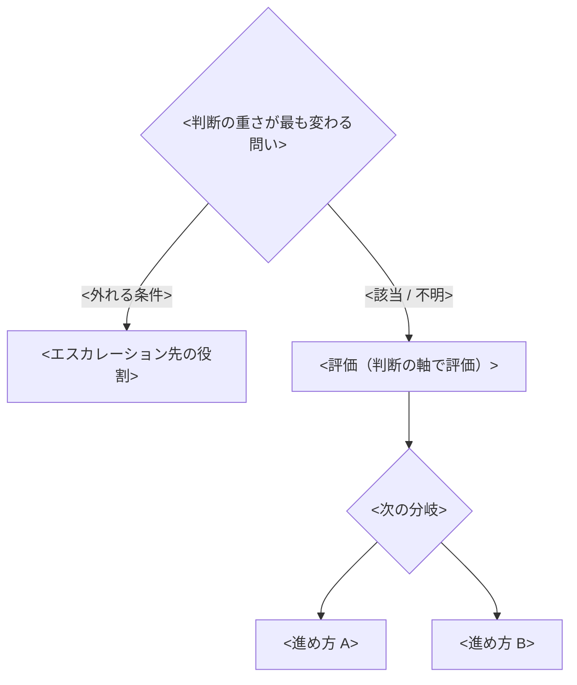

# ガイドラインの骨子

アウトラインと、各節に何を書くかの説明。文例は一例であり、書く対象は節ごとの「書くこと」で判断する。省いてよいのは、用語、<隣の活動>との違い、関係者、未確定事項の 4 節だけである。活動に当てはまらなければ節ごと省く。それ以外の節は省かない。

## アウトライン

```markdown
# <活動名>ガイドライン

## 概要
## 目的
## スコープ
## 用語
## <隣の活動>との違い
## 前提をそろえる
## フロー
## 判断の軸
## 関係者
## エスカレーション
## 例外とフローの外
## 成果物
## ケーススタディ
## 未確定事項
## 更新条件
## 参考
```

目的とスコープを手順より先に置く。順序を入れ替えると、手順だけが参照されて例外の場面で判断できなくなる。

| 節 | 答える問い |
| :--- | :--- |
| 概要 | これは何のガイドラインか |
| 目的 | このガイドラインがあると何がそろうか |
| スコープ | 何を決め、何を委ね、何を上げ、何を扱わないか |
| 用語 | どの語をどの意味で使うか |
| <隣の活動>との違い | 取り違えやすい活動と何が違うか |
| 前提をそろえる | 着手前に何が分かっていればよいか |
| フロー | 入口から出口までどう進むか |
| 判断の軸 | 何を見て評価するか |
| 関係者 | 誰に、なぜ、いつ相談するか |
| エスカレーション | 自分たちで決めないのはどれか |
| 例外とフローの外 | フローに乗らないときどうするか |
| 成果物 | 各ステップで何を出すか |
| ケーススタディ | 実際にどの経路を通ったか |
| 未確定事項 | まだ決めきれていないのは何か |
| 更新条件 | 何が起きたら見直すか |
| 参考 | どこから骨格を借りたか |

## 各節に何を書くか

### 概要

書くこと: 誰が、どの活動を、どう進めるためのガイドラインかを 1 文で書く。

### 目的

書くこと: このガイドラインを引くことで、誰の、どの活動が、どうそろうかを 1〜2 文で書く。そろった状態が複数あるなら、状態ごとに箇条書きにする。

判断の基準: このガイドラインを引いて進めたい実例を 3 つ挙げ、目的がそれを説明できるか。

書かないこと: 手順の要約。それはフローの節で足りる。

### スコープ

書くこと: 決めること（活動の進め方）、委ねること（価値基準と技術基準は原則へ、操作手順は手順書へ、他チームの実務は他チームの文書へ）、上げること（組織や事業の判断）、扱わないこと。

判断の基準: 読者が、このガイドラインだけで最後まで進めるのか、途中で別の文書を見るのかを判別できるか。扱わない範囲が書かれていないと、未決なのか意図的に範囲外なのかを区別できない。

### 用語

書くこと: この活動で使う語の定義を「用語／定義／例」の表にする。標準の定義に寄せ、出典を添える。標準に定義がない語は、自分たちの整理であると書く。

判断の基準: 定義した語が本文で実際に使われているか。

書かないこと: 読者の前提知識で足りる一般的な技術用語の説明。

### <隣の活動>との違い

書くこと: 読者が取り違えやすい活動との違いを、対象、問い、見つかるもの、タイミング、出力などの観点で表にする。

判断の基準: この節を読んだ人が、目の前の案件をどちらの活動で扱うかを決められるか。取り違える活動がなければ節ごと省く。

### 前提をそろえる

書くこと: 着手前にそろえておく情報と、そろっていないときに何をするか。対象の目的、構成、既存の状況、過去の事例、期限感など。そろっていなければ、その機会に作ると明記する。

判断の基準: 挙げた前提ごとに、無いまま進むと何が起きるかを言えるか。

### フロー

書くこと: 入口から出口までの型。分岐つきの図と、各終端で誰が何を決めるかの文章。

- 入口と記録先を一箇所に固定する（どこで受け付け、やりとりと結論をどこに残すか）
- 最初の分岐に、判断の重さが最も大きく変わる問いを置く
- 答えが分からない分岐は重い側に倒す
- 結論が否定になる終端ほど、返す内容の書式を決める（理由、将来の可能性、代替経路）

判断の基準: 分岐が 3〜4 に収まっているか。過去の実際の対応を 3 件、この図の上でなぞれるか。

書かないこと: 図だけを置いて説明を省くこと。

### 判断の軸

書くこと: 評価の観点を、その活動のどの案件にも使える少数の軸として「軸／問い」の表にする。問いに推測なしで答えられるかを確かめるよう添える。

判断の基準: 軸がその活動のどの案件にも使えるか。特定の案件でしか使えない観点は、手順の一部である。

書かないこと: 領域固有の技術基準と、軸の間の優先順位。原則へリンクする。

### 関係者

書くこと: 「相手／相談する理由／タイミング」の表。タイミングは活動の中の出来事で書く。承認が要る相手と、情報を渡すだけの相手を分ける。相手が担う実務に自分たちが渡す情報があるなら、その項目を列挙する。

判断の基準: 活動の途中で「この人に先に話しておくべきだった」が起きないか。巻き込む相手がいない活動なら節ごと省く。

### エスカレーション

書くこと: 自分たちで決める論点と、上げる論点の見分け方を「論点の型／例／扱い」の表にする。技術判断（妥当か、どう作るべきか）と対応コミット（やるか、いつやるか）を分ける。

判断の基準: エスカレーション先が役割で書かれているか。上げたあと誰が答えを返すかまで決まっているか。

### 例外とフローの外

書くこと: フローの外で扱う案件（緊急対応など）と、そのときに何を優先するか。フロー外で進めてよい条件、誰に知らせるか、何を残すか（乗せなかった理由）。同じ型の例外が繰り返されたら更新条件につなぐこと。

判断の基準: 例外を禁止していないか。

### 成果物

書くこと: 各ステップの出力を、コピーして使える表や雛形として置く。終端ごとに雛形を分ける。記入例を 1 行入れる。特殊ケースは雛形の注記で扱う。

判断の基準: この雛形を埋めれば次のステップに進めるか。埋めても情報が足りないなら、列が足りない。

### ケーススタディ

書くこと: 実際の対応を「案件／状況／フロー経路／結論」の表にする。公開後は判断のたびに追記する。フローを変えたら、既存の経路を新しいフローで引き直し、旧経路は併記する。

判断の基準: 経路を書けない案件が続いていないか。

### 未確定事項

書くこと: まだ決めきれていない論点と、今の暫定の運用、何の事例が増えれば決められるか。

判断の基準: 空欄や「検討中」だけで終わっていないか。

### 更新条件

書くこと: 何が起きたら見直すかを具体的に書く（経路に乗らない案件が 2 回、委ねている原則の改訂、体制の変更）。

判断の基準: 「運用しながら継続的に更新する」だけで終わっていないか。

### 参考

書くこと: 借りた標準やフレームワークと、どの役割で採ったか（プロセス、採点、洗い出し、観点）。骨格から外した部分は、外した理由も書く。

判断の基準: 複数の標準を引いたとき、読者がどれに従えばよいか迷わないか。

## 共通の書き方

- 空欄を残さない。未定なら「未定」と書き、決める場所を指す
- エスカレーション先と関係者は役割で書く
- 手順の前に目的とスコープを置く
- 雛形には記入例を 1 行入れる
- ケーススタディには経路を必ず書く

## 記入例

一例であり、この書き方に合わせる必要はない。

````markdown
## フロー



<図の直後に、入力と出力、各終端で誰が何を決めるかを文章で書く。>

## 判断の軸

| 軸 | 問い |
| --- | --- |
| <軸> | <この軸で何を確かめるか> |

## 関係者

| 相手 | 相談する理由 | タイミング |
| --- | --- | --- |
| <役割> | <何のオーナーか、何を決めてもらうか> | <活動の中の出来事> |

## エスカレーション

| 論点の型 | 例 | 扱い |
| --- | --- | --- |
| 技術判断 | <例> | <フローに沿って対応> |
| 組織や事業の判断 | <例> | <役割名>にエスカレーション |

## ケーススタディ

| 案件 | 状況 | フロー経路 | 結論 |
| --- | --- | --- | --- |
| [<Issue>](<URL>) | <状況> | <仕分け → 評価（軸）→ 進め方> | <結論> |

## 未確定事項

- <論点>: <今の暫定の運用>。<何の事例が増えれば決められるか>
````
