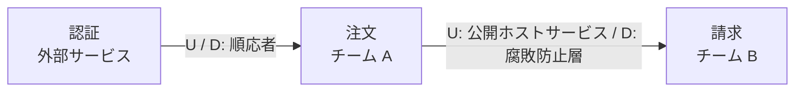

# コンテキストの関係の型

## 関係の型

| 型 | どういう関係か | 向いている場面 | 注意 |
| :--- | :--- | :--- | :--- |
| パートナーシップ | 二つのチームが互いに合わせ、一緒に計画して変更する | 二つのコンテキストが同時に成功しないと意味がない | 調整の手間が大きい。長く続けるほど負担になる |
| 共有カーネル | モデルの一部を共有し、両方のチームで持つ | 共有する部分が小さく、変更が少ない | 共有部分を広げない。変更は両チームの合意が要る |
| 顧客／供給者 | 上流が下流の要望を受けて提供する | 上流が下流の要望を計画に入れられる | 下流の要望を、上流の優先度に入れる仕組みが要る |
| 順応者 | 下流が上流のモデルにそのまま合わせる | 上流を変えられず、上流のモデルで困らない | 下流がコアなら選ばない。上流のモデルに引きずられる |
| 腐敗防止層 | 下流が変換の層を置き、上流のモデルを自分のモデルに訳す | 上流のモデルが下流に合わない。上流が外部や古いシステム | 変換の層の保守が要る |
| 公開ホストサービス | 上流が、複数の下流向けに決まった形の API を提供する | 下流が多く、個別に合わせられない | 形を変えるときの互換性を守る |
| 公表された言語 | 上流と下流が、文書化された共通の形式でやりとりする | 公開ホストサービスと組み合わせる。業界標準の形式がある | 形式の版を管理する |
| 別々の道 | つながず、それぞれで作る | つなぐ価値より、つなぐ手間が大きい | 同じ機能を二度作ることになる |
| 大きな泥団子 | 境界がなく、モデルが混ざっている | 既存のシステムを、そのまま描くときに使う | 目指す形ではない。腐敗防止層で囲って、外に広げない |

## 選び方

1. 上流と下流を決める。どちらのモデルが、どちらに影響するか
2. 上流のチームが、下流の要望を聞けるかを確かめる
   - 聞ける: 顧客／供給者、またはパートナーシップ
   - 聞けない: 順応者、または腐敗防止層
3. 下流がコアドメインなら、上流のモデルを入れないために腐敗防止層を選ぶ
4. 上流が多くの下流に使われるなら、公開ホストサービスと公表された言語を選ぶ
5. つなぐ必要が薄いなら、別々の道を選ぶ

## 図の書き方

- コンテキストを箱にし、名前と担当チームを書く
- 関係を線でつなぎ、上流に U、下流に D を添える
- 線に関係の型の名前を添える

